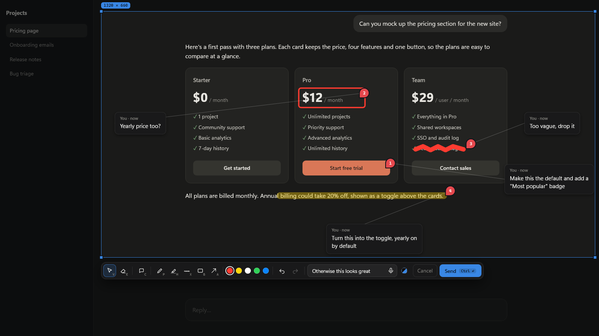
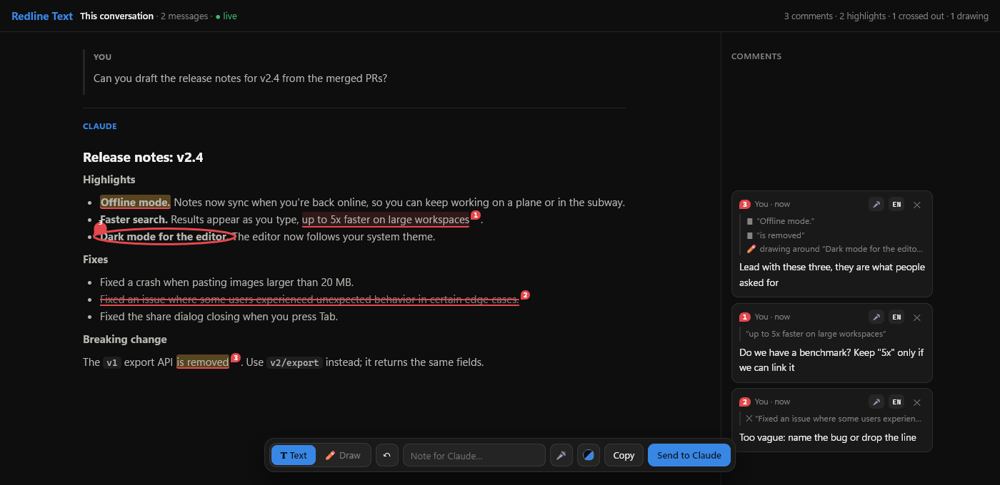

# Redline

Mark up what Claude shows you instead of describing it. A Claude Code mod for Windows.

No more "the second button on the left, no, the other one". Point at it, scribble on it, pin a comment on it, and send it to Claude.

### Capture screen

Freeze the screen, drag a box, then draw, highlight and pin comments right on it. **Send** puts the marked-up image in front of Claude, along with the text under your marks (read with Windows OCR).



### Review conversation

Long reply? Open the whole conversation in its own window, kept live as Claude answers. Select text to comment on it, highlight it or cross it out, or switch to **Draw** and circle things. One comment can cover several marks. Claude gets the exact quotes and where they are, so it never has to guess what you meant.



Also included: dictation in comments (🎤), seven colour palettes, and the global hotkey **Ctrl+Alt+Shift+R**.

## Install

Requirements: Windows 10/11, [Node.js](https://nodejs.org) and Microsoft Edge.

In Claude Code:

```
/plugin marketplace add betemonkey/redline
/plugin install redline@monkey-mods
```

Then start a new session (or run `/reload-plugins`).

## Use

| Where | How |
| --- | --- |
| Claude app (Code tab) | the Redline logo + ▾ above the chat box, after the first message |
| Claude Code CLI | the `[ ▾ ]` row above the prompt |
| Anywhere | `/redline` (capture), `/redline text` (review conversation), `/redline discard` |
| Outside Claude | **Ctrl+Alt+Shift+R** captures; the result waits as a card for your next message |

Claude apps that host Claude Code in their own chat window may not draw the row; the slash commands and the hotkey still work there.

### Standalone review page

`app/text.html` also works on its own, with no Claude Code and no install. Open it in a browser, paste a reply, mark it up, then press **Copy** and paste the result into any chat. This suits locked-down machines.

## Data

Captures, the send queue and preferences live in `%LOCALAPPDATA%\Redline` (set `REDLINE_DATA` to use another folder). Redline runs its own Edge profile there too. Nothing leaves your machine except what you send to Claude.
